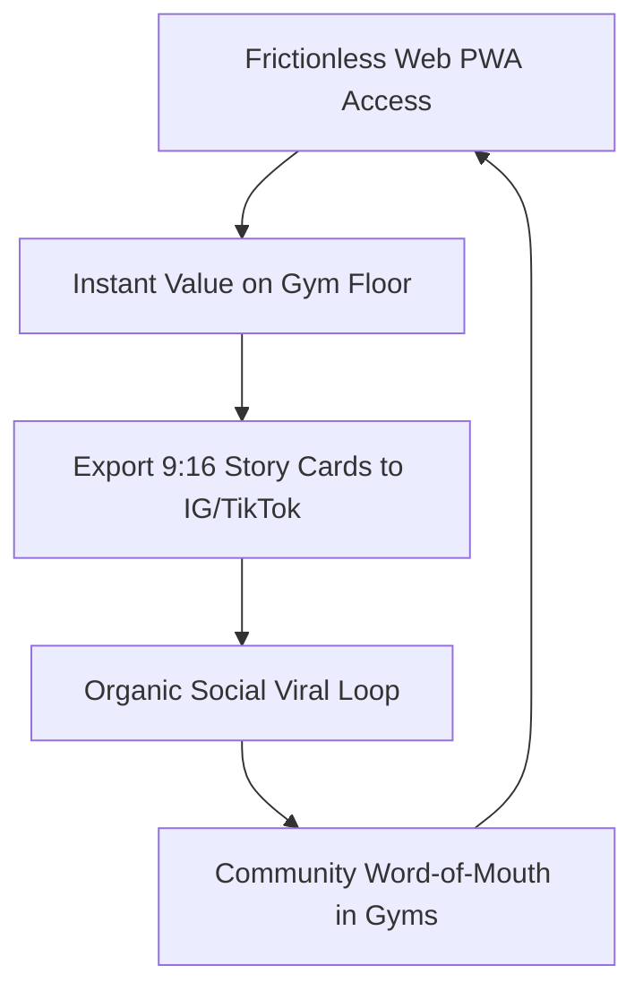

# 🏋️‍♂️ LOGBOOK: System Documentation & Pitch Deck
**Product**: Logbook Gym Tracker & High-Performance Fitness OS  
**Repository**: [github.com/mazev-erse/Logbook](https://github.com/mazev-erse/Logbook)  
**Platform**: Progressive Web App (PWA) & Mobile (Capacitor)  

---

# TABLE OF CONTENTS
1. [Executive Summary & System Architecture](#1-executive-summary--system-architecture)
2. [Structural Documentation of Features & Modules](#2-structural-documentation-of-features--modules)
   - 2.1 [Active Workout & Ergonomic Logging Engine](#21-active-workout--ergonomic-logging-engine)
   - 2.2 [Olympic Barbell Plate Calculator & 1RM Engine](#22-olympic-barbell-plate-calculator--1rm-engine)
   - 2.3 [Hands-Free Background Rest Timer](#23-hands-free-background-rest-timer)
   - 2.4 [Routines & Split Template Architect](#24-routines--split-template-architect)
   - 2.5 [Nutrition & Macro Engine with Dual Databases](#25-nutrition--macro-engine-with-dual-databases)
   - 2.6 [Active Recovery, Sports & Sleep Module](#26-active-recovery-sports--sleep-module)
   - 2.7 [Habit Psychology: 36-Hour Grace Period & Gamification](#27-habit-psychology-36-hour-grace-period--gamification)
   - 2.8 [Social Share Card Generator (Canvas Engine)](#28-social-share-card-generator-canvas-engine)
   - 2.9 [Data Sovereignty & Local-First Privacy Hub](#29-data-sovereignty--local-first-privacy-hub)
   - 2.10 [Superadmin Suite & System Telemetry](#210-superadmin-suite--system-telemetry)
3. [User Operating Manual: Step-by-Step Flow](#3-user-operating-manual-step-by-step-flow)
4. [Value Proposition & User Benefits](#4-value-proposition--user-benefits)
5. [Macro Impact Analysis](#5-macro-impact-analysis)
6. [Complete Pitch Deck (Slide-by-Slide)](#6-complete-pitch-deck-slide-by-slide)

---

# 1. Executive Summary & System Architecture

Logbook is a mobile-first Progressive Web Application (PWA) engineered specifically for strength training, body composition, athletic recovery, and habit preservation.

```
┌────────────────────────────────────────────────────────────────────────────────────────┐
│                                LOGBOOK 360° ECOSYSTEM                                 │
├─────────────────────┬──────────────────────┬────────────────────┬──────────────────────┤
│   TRAINING FLOOR    │    NUTRITION & FUEL  │ RECOVERY & SLEEP   │ RETENTION & SOCIAL   │
├─────────────────────┼──────────────────────┼────────────────────┼──────────────────────┤
│ • 56px Touch Zones  │ • USDA + Local BD DB │ • Circadian Sleep  │ • 36h Streak Rescue  │
│ • Ghost Rep Memory  │ • Macro HUD (TDEE)   │ • Cross-Sport Log  │ • Trophy Cabinet     │
│ • Barbell Plate Math│ • Custom Meal Tabs   │ • Fatigue (sRPE)   │ • Canvas Social Card │
│ • Active Rest Timer │ • Supplement Tracker │ • Recovery Alerts  │ • JSON/CSV Data Hub  │
└─────────────────────┴──────────────────────┴────────────────────┴──────────────────────┘
```

### Core Architecture & Tech Stack:
- **Frontend**: React 19, TypeScript, Vite 8, Tailwind CSS v4 (`@tailwindcss/vite`)
- **PWA & Offline-First**: `vite-plugin-pwa`, Workbox Service Workers, Web App Manifest
- **Mobile Container**: Capacitor Android (`@capacitor/android`, `@capacitor/core`)
- **Backend & Database**: Supabase (PostgreSQL 15+, Row Level Security, RPC Functions)
- **Authentication**: Anonymous UUID on launch, seamless promotion to Google OAuth / Email
- **Data Visualization**: Recharts, Canvas Confetti, HTML5 Canvas API

---

# 2. Structural Documentation of Features & Modules

### 2.1 Active Workout & Ergonomic Logging Engine
*Source Code: `src/components/workout/ActiveWorkoutView.tsx`, `WorkoutLogger.tsx`, `WorkoutDebriefModal.tsx`*
- **OLED Pitch-Black Palette (`#050508`)**: Engineered specifically for high-glare gym lighting and maximum battery preservation on OLED mobile screens during 90-minute workouts.
- **56px Minimum Tap Targets**: Large touch targets ensure error-free tapping even with chalk-covered, sweaty, or shaking hands.
- **Ghost Reference Memory**: Automatically displays the lifter's previous session weight and reps directly next to the active input row, eliminating mental arithmetic and driving progressive overload.
- **One-Tap Completion**: Tapping the checkmark completes the set, triggers haptic confirmation (`navigator.vibrate`), and automatically engages the rest timer.
- **Session Debrief & Fatigue Profiling**: Post-workout debrief captures Session RPE (1–10), psychological mood badges (🔥 *Beast Mode*, 💪 *Felt Strong*, 🥱 *Pushed Through*, 💀 *Crushed*), star ratings, and cumulative tonnage lifted.

### 2.2 Olympic Barbell Plate Calculator & 1RM Engine
*Source Code: `src/components/workout/SetDetailDrawer.tsx`, `src/lib/plateCalculator.ts`, `src/lib/utils.ts`*
- **Automated Barbell Breakdown**: Computes the exact disc loading configuration per side for standard 20kg Olympic barbells across standard weights (25kg, 20kg, 15kg, 10kg, 5kg, 2.5kg, 1.25kg) using color-coded IPF standards.
- **Estimated 1RM (Epley Formula)**:
  $$\text{1RM} = \text{Weight} \times \left(1 + \frac{\text{Reps}}{30}\right)$$
  Computes instantaneous theoretical maximal strength dynamically across sets.
- **RPE Rating Selector**: Integrated Rate of Perceived Exertion (RPE 6.0 to 10.0) selector allowing lifters to gauge Reps in Reserve (RIR).
- **Instant Weight Steppers**: Rapid ±2.5kg, ±5kg, and ±10kg nudge buttons to change load without opening the software keyboard.

### 2.3 Hands-Free Background Rest Timer
*Source Code: `src/components/common/RestTimerBar.tsx`, `src/hooks/useRestTimer.ts`*
- **Timestamp-Based Elapsed Calculation**: Unlike standard `setInterval` timers that freeze when iOS or Android puts background browser tabs to sleep, Logbook calculates remaining duration from the delta of wall-clock timestamps.
- **Web Audio API Acoustic Chime**: Synthesizes a high-frequency acoustic bell chime entirely in code without needing external audio asset downloads.
- **Multi-Modal Sensory Feedback**: Triggers haptic vibration patterns (`[200ms, 100ms, 200ms]`) on mobile devices so lifters wearing headphones feel the cue.
- **Thumb-Zone Steppers**: Floating HUD placed in the natural thumb zone with quick `+30s` / `-30s` adjustment chips.

### 2.4 Routines & Split Template Architect
*Source Code: `src/components/routines/Routines.tsx`, `src/components/routines/RoutineBuilderModal.tsx`*
- **Pre-Loaded Standard Splits**: Out-of-the-box support for Push, Pull, and Legs templates.
- **Custom Routine Builder**: Full re-ordering, per-exercise target sets, target reps, and exercise swapping.
- **Instant Session Hydration**: One click hydrates a live workout session with target exercises, pre-filled target reps, and historical weights.

### 2.5 Nutrition & Macro Engine with Dual Databases
*Source Code: `src/components/diet/DietOrganizer.tsx`, `FoodLoggingModal.tsx`, `MealCategoryManagerModal.tsx`, `AddSupplementModal.tsx`*
- **Macronutrient Progress HUD**: Real-time progress bars for Calories, Protein, Carbohydrates, and Fats balanced against Mifflin-St Jeor TDEE calculations.
- **Dual Database Architecture**:
  1. *USDA Global Database*: Standard western nutrition data.
  2. *Regional/Bangladeshi Food Database*: Covers localized diets (e.g., Khichuri, Beef Bhuna, Lentil Dal, Roti, Hilsa Fish) that traditional western apps neglect.
- **Dynamic Gram Scaler**: Automatically scales macro and calorie values as the user adjusts the portion gram slider.
- **Custom Category Manager**: Users can customize meal periods (Pre-Workout, Post-Workout, Suhoor, Iftar, Late Night) with custom icons.
- **Daily Supplement Checklist**: Single-tap tracking for daily essentials (Creatine Monohydrate, Whey Isolate, Omega-3, Multivitamins).

### 2.6 Active Recovery, Sports & Sleep Module
*Source Code: `src/components/home/SportsRecoverySection.tsx`, `LogActivityModal.tsx`, `src/components/sleep/LogSleepModal.tsx`, `useActiveRecovery.ts`*
- **Cross-Sport Caloric Logging**: Logs non-gym athletic pursuits (Cricket, Football, Badminton, Swimming, Running, Cycling, Walking) with automated metabolic equivalent (MET) calorie and step estimations.
- **Overtraining Warnings**: Warns lifters when intense sports volume overlaps heavily with leg training days to protect the central nervous system.
- **Circadian Sleep Tracking**: Logs bedtime, wake-up time, sleep duration, and subjective sleep quality (*Poor*, *Fair*, *Good*, *Excellent*), with automated bedtime reminders.

### 2.7 Habit Psychology: 36-Hour Grace Period & Gamification
*Source Code: `src/components/home/StreakRescueBanner.tsx`, `src/components/profile/TrophyCabinet.tsx`, `src/utils/streakProtection.ts`*
- **The 36-Hour Grace Period**: Traditional 24-hour streak systems penalize users whose schedules shift by a few hours, causing the "what-the-hell" psychological failure effect. Logbook provides an automated 12-hour buffer (36 hours total), surfacing an ambient amber *Streak Rescue* banner to encourage adherence rather than punishment.
- **4-Tier Trophy Cabinet**: Multi-stage achievement badges across Bronze, Silver, Gold, and Platinum tiers recognizing cumulative volume milestones, streak records, and personal records.

### 2.8 Social Share Card Generator (Canvas Engine)
*Source Code: `src/components/history/ShareWorkoutModal.tsx`, `src/utils/canvasCardGenerator.ts`*
- **Client-Side Canvas Rendering**: Exports pixel-perfect, high-resolution graphics directly to PNG without third-party server processing.
- **Dual Aspect Ratios**:
  * `9:16` Story Format (1080 × 1920) optimized for Instagram Stories and TikTok.
  * `1:1` Square Format (1080 × 1080) for feed posts.
- **Aesthetic Branding**: Features deep carbon backgrounds, neon emerald accents, total tonnage lifted, set breakdowns, and mood emojis.

### 2.9 Data Sovereignty & Local-First Privacy Hub
*Source Code: `src/components/profile/DataManagementModal.tsx`, `src/utils/csvExport.ts`, `src/utils/csvImportParser.ts`*
- **Frictionless Anonymous Auth**: Uses Supabase anonymous authentication so users can start logging immediately without entering an email or password.
- **Seamless Account Promotion**: Allows upgrading to Google OAuth or Email credentials later without losing any anonymous session history.
- **Full Data Portability**: Complete JSON and CSV backup exports and CSV restoration parsers. The user always owns their data.

### 2.10 Superadmin Suite & System Telemetry
*Source Code: `src/components/admin/AdminDashboard.tsx`, `supabase/schemas/08_admin_dashboard_rpc.sql`*
- **Role-Based Access Control (RBAC)**: Secure admin views locked to designated root emails.
- **Platform Metrics**: Live counters for total registered lifters, workouts completed, cumulative kilograms moved, and diet logs.
- **User Management**: Direct search, activity inspection, and CSV export for community analytics.

---

# 3. User Operating Manual: Step-by-Step Flow


1. **Before the Gym**: The user checks the **Home Dashboard**, notices their streak status, and picks a split (e.g., *Push Day*) from the **Routines Drawer**.
2. **On the Gym Floor**:
   - The user opens the first exercise (*Barbell Bench Press*).
   - The screen shows their last session’s performance (*80kg × 8 reps*).
   - They load 82.5kg. Unsure of the plate math, they tap the set row: the **Plate Breakdown Drawer** shows: *One 20kg, one 10kg, and one 1.25kg plate per side*.
   - They complete the set and tap the **Checkmark**.
   - The screen pulses green, haptic feedback triggers, and the **Floating Rest Timer** counts down from 90 seconds while they step away from their phone.
3. **Rest & Next Set**:
   - At 0 seconds, a clear chime sounds through their headphones.
   - They complete all sets, then hit **Finish Workout**.
   - The **Workout Debrief** pops up: they log their session RPE (*8/10*), choose 🔥 *Beast Mode*, and celebrate with confetti.
   - They tap **Share**, and an Instagram Story graphic card (9:16) is saved to their phone gallery.
4. **Kitchen & Evening**:
   - In the **Diet Tab**, they log lunch by typing *"Beef Bhuna with White Rice"*. The Bangladeshi food catalog automatically calculates calories and protein.
   - They check off *Creatine* in their **Supplement Checklist**.
5. **Nighttime**:
   - Before sleeping, they log their bedtime. The app reminds them when it's time to recover for tomorrow's session.

---

# 4. Value Proposition & User Benefits

| Pain Point in Current Apps | How Logbook Solves It | User Benefit |
| :--- | :--- | :--- |
| **Account Creation Friction** (Mandatory sign-ups, paywalls before the first set) | Instant local anonymous sign-in via Supabase UUID | Users log their first set within 5 seconds of opening the app. |
| **Cluttered, Ad-Heavy Interfaces** | Zero ads, minimalist dark mode (`#050508`) with 56px oversized touch targets | Fast, distraction-free logging that works with sweaty hands and cuts OLED glare. |
| **Mental Math & Overload Confusion** | Ghost reference memory + Epley 1RM + automated 20kg bar plate breakdown | Removes cognitive fatigue during heavy lifting sessions. |
| **Rigid 24h Streak Guilt** (Missing a day breaks a multi-month streak) | 36-hour grace window with proactive *Streak Rescue* banners | Sustains long-term motivation without toxic guilt or burnout. |
| **Western-Centric Food Databases** | Dual DB integration: USDA + Hyper-local South Asian/Bangladeshi foods | Accurate macro tracking for diverse, culturally authentic meals. |
| **Siloed Ecosystems** (Lifting in one app, food in another, recovery ignored) | Unified hub for Lifting, Food, Supplements, Active Sports, and Sleep | Complete picture of overall physical recovery and progression in one place. |
| **Walled Gardens & Hostage Data** | Native CSV/JSON data export and import tools | Lifters retain complete ownership of their fitness and biometric data. |

---

# 5. Macro Impact Analysis

### 1. Physiological Impact (Gains & Longevity)
* **Progressive Overload Adherence**: Consistent visibility of past session performances prevents "workout meandering," systematically increasing volume over time.
* **Injury Prevention via RPE**: Tracking subjective exertion helps lifters identify central nervous system (CNS) fatigue before acute soft-tissue injuries occur.
* **Balanced Recovery**: Tracking non-gym sports and sleep quality ensures training load doesn't outpace systemic recovery.

### 2. Psychological Impact (Sustained Consistency)
* **Elimination of the "What-the-Hell" Effect**: When people miss a rigid 24-hour streak deadline, they often abandon their routine entirely. The 36-hour grace period provides an empathetic safety net that keeps habits intact.
* **Extrinsic to Intrinsic Motivation**: Tiered badges (Bronze to Platinum) reward effort early, helping novice lifters build the momentum needed for long-term discipline.

### 3. Cultural & Inclusivity Impact
* Most major fitness apps (MyFitnessPal, Cronometer, Strong) are tailored for Western diets and gym environments. Logbook's native support for South Asian nutritional staples brings modern macro tracking to historically underserved fitness communities.

---

# 6. Complete Pitch Deck (Slide-by-Slide)

```
==========================================================================================
                                  LOGBOOK PITCH DECK
                     "The High-Performance Operating System for Lifters"
==========================================================================================
```

### SLIDE 1: Title & Vision
* **Headline**: LOGBOOK
* **Sub-headline**: The High-Performance Operating System for Strength, Nutrition, and Recovery.
* **Tagline**: Frictionless in the gym. Unforgiving on results.
* **Presenter**: mazev-erse Team

---

### SLIDE 2: The Problem
* **Headline**: Fitness Apps Are Broken on the Gym Floor.
* **Three Critical Flaws**:
  1. *Friction & Bloat*: Cluttered with social feeds, video paywalls, and tiny buttons that are impossible to tap with sweaty, chalky hands.
  2. *Siloed & Incomplete*: Lifters are forced to juggle 3–4 separate apps for lifting logs, macro counting, and sleep tracking.
  3. *Punitive Habit Loops*: Rigid 24-hour streak counters induce guilt and lead to abandonment when life happens.

---

### SLIDE 3: The Solution
* **Headline**: Logbook — Built for the Reality of the Weight Room.
* **Key Pillars**:
  * **Gym-First Ergonomics**: Deep true-black OLED theme, 56px oversized touch targets, and bottom-heavy navigation designed for one-handed thumb reach.
  * **Unified 360° Tracking**: Lifting, Barbell Plate Mathematics, Nutrition (with regional foods), Cross-Sports, and Sleep under one roof.
  * **Empathetic Retention**: A 36-hour grace window that keeps lifters consistent without toxic streak anxiety.

---

### SLIDE 4: Ergonomic & Tech Innovation
* **Headline**: Engineered for Zero Distractions.
* **The Innovations**:
  * *Ghost Reps*: Displays your previous session's weight and reps automatically.
  * *Olympic Barbell Solver*: Instant per-side plate loading for standard 20kg bars.
  * *Background-Safe Rest Timer*: Timestamp-based elapsed calculation that never freezes when your phone screen turns off, paired with synthesized Web Audio chimes and haptic pulses.
  * *Local-First PWA*: Works offline in basement gyms with instant anonymous onboarding.

---

### SLIDE 5: Product Walkthrough & Architecture
```
┌────────────────────────────────────────────────────────────────────────┐
│                        THE FIVE CORE PILLARS                           │
├─────────────┬─────────────┬──────────────┬──────────────┬──────────────┤
│ 1. WORKOUT  │ 2. PLATES   │ 3. NUTRITION │ 4. RECOVERY  │ 5. RETENTION │
│ 56px taps   │ 20kg bar    │ USDA + Local │ Cross-sports │ 36h Grace    │
│ Ghost reps  │ IPF colors  │ Macro HUD    │ Sleep cycles │ Trophies     │
│ sRPE debrief│ 1RM trends  │ Supplements  │ CNS alerts   │ Canvas cards │
└─────────────┴─────────────┴──────────────┴──────────────┴──────────────┘
```

---

### SLIDE 6: The Competitive Advantage
* **Headline**: Why Logbook Wins Against Legacy Apps.

| Feature / Metric | Logbook | Strong / Hevy | MyFitnessPal | Pen & Paper |
| :--- | :---: | :---: | :---: | :---: |
| **Instant Onboarding (No Signup)** |  Yes | ❌ No | ❌ No |  Yes |
| **Sweat-Proof 56px Ergonomics** |  Yes | ❌ Small taps | ❌ Small taps | ❌ Cumbersome |
| **Built-in Plate Math & Rest Audio**|  Yes |  Partial (Paywall)| ❌ No | ❌ Manual |
| **Lifting + Nutrition Unified** |  Yes | ❌ Lifting Only|  Food Only | ❌ Manual |
| **Culturally Diverse Food DB** |  Yes | ❌ Western Only| ⚠️ User-polluted| ❌ Manual |
| **Compassionate 36h Streak Rescue** |  Yes | ❌ Rigid 24h | ❌ Rigid 24h | ❌ None |
| **Full Data Export (CSV/JSON)** |  Free | ⚠️ Paywalled | ⚠️ Paywalled |  Physical |

---

### SLIDE 7: Market Opportunity & Target Personas
* **TAM (Total Addressable Market)**: Global Fitness App Market — **\$19.3 Billion by 2030** (CAGR 17.6%).
* **SAM (Serviceable Addressable Market)**: Strength training, bodybuilding, and powerlifting app users (**\$3.2 Billion**).
* **SOM (Serviceable Obtainable Market)**: Mobile-first functional fitness athletes, powerlifters, and gym-goers seeking an all-in-one tracker (**\$150 Million**).
* **Target Personas**:
  1. *The Dedicated Lifter*: Tracks progressive overload, plates, RPE, and needs fast, distraction-free logging.
  2. *The Hybrid Athlete*: Lifts weights 4x/week, plays weekend sports (cricket, football), and tracks overall fatigue.
  3. *The Cultural Fitness Enthusiast*: Tracks macros accurately while eating regional, home-cooked meals.

---

### SLIDE 8: Business & Monetization Model
* **Freemium Core (The Growth Engine)**:
  * Full logging, plate math, custom routines, local food logging, and CSV exports remain completely free.
* **Logbook Pro Tier (\$4.99/mo or \$39.99/yr)**:
  * Advanced predictive 1RM modeling and fatigue algorithms.
  * Cloud sync across unlimited devices with multi-client coach access.
  * Premium Canvas Story layouts and custom plate inventory management.
* **B2B Coaching & Gym SaaS**:
  * White-label trainer dashboard allowing coaches to push routines and monitor client compliance in real time.

---

### SLIDE 9: Technology Stack & Defensibility
* **Frontend**: React 19, TypeScript, Vite 8, Tailwind CSS v4.
* **Offline PWA**: Service Workers, Workbox, Web App Manifest, Capacitor Android support.
* **Backend & Security**: Supabase PostgreSQL with strict Row Level Security (RLS) policies.
* **Client-Side Media & Graphics**:
  * HTML5 Canvas API for pixel-perfect social cards.
  * Web Audio API for synthetic rest chimes.
  * Client-side image compression for avatars.
* **Defensibility**: Low infrastructure costs due to local-first client computing, fast performance, and high user retention from the 36-hour grace period.

---

### SLIDE 10: Growth & Go-to-Market (GTM)

* **Organic Viral Engine**: Every PR and workout completion produces an aesthetically styled 9:16 Canvas card ready for Instagram Stories, turning active lifters into brand advocates.
* **Campus & Local Gym Partnerships**: Campus lifting clubs and cross-training boxes onboard members via simple QR code scans without app store friction.
* **SEO & Tool Funnels**: Free web-based standalone tools (e.g., *Online Barbell Plate Calculator*, *Epley 1RM Estimator*) that funnel users directly into the PWA.

---

### SLIDE 11: Roadmap & Vision
* **Phase 1 (Current - V1.0)**: Production-ready PWA, full workout logging, dual food databases, plate math, sleep tracker, canvas card generator, and superadmin telemetry.
* **Phase 2 (Next 6 Months)**: Wearable biometric synchronization (Apple HealthKit / Google Health Connect) and AI meal photo recognition.
* **Phase 3 (Next 12–18 Months)**: Coach-to-athlete interactive programming and localized gym leaderboards.

---

### SLIDE 12: The Vision & Summary
* **Vision**: To eliminate mental clutter on the gym floor and build the world’s most accessible, reliable, and respectful fitness operating system.
* **Summary**:
  * ✅ Fast, local-first performance.
  * ✅ Ergonomically engineered for one-handed gym floor usage.
  * ✅ Combines training, nutrition, sports, and sleep into a single experience.
  * ✅ Backed by compassionate retention psychology and full user data sovereignty.
